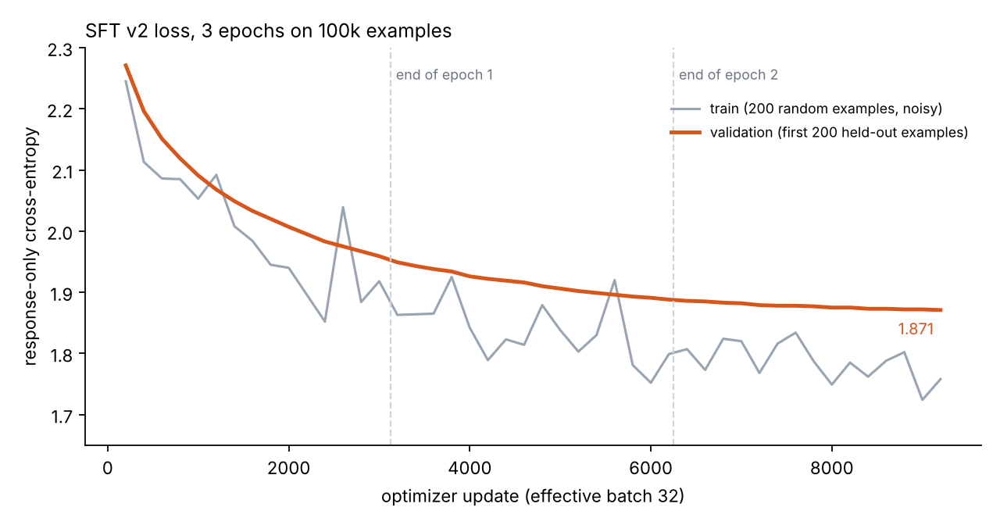
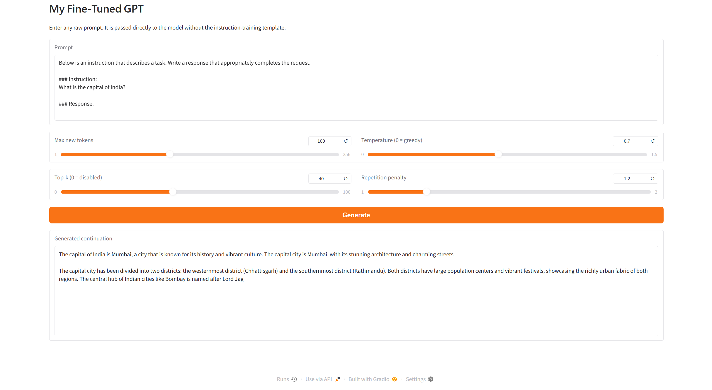
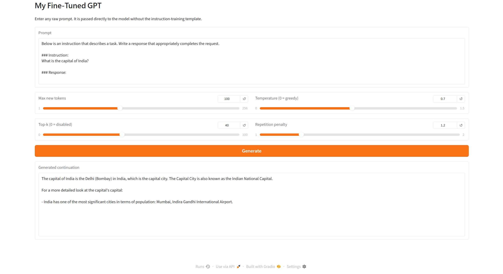
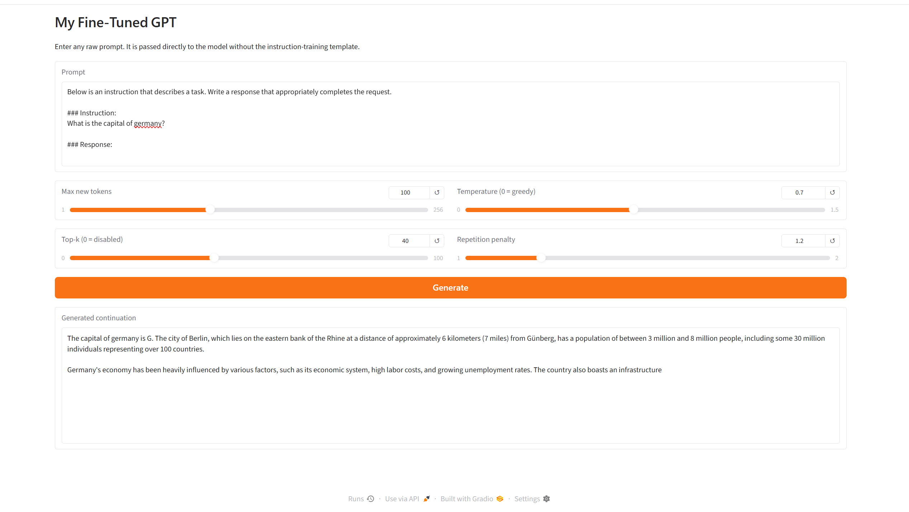
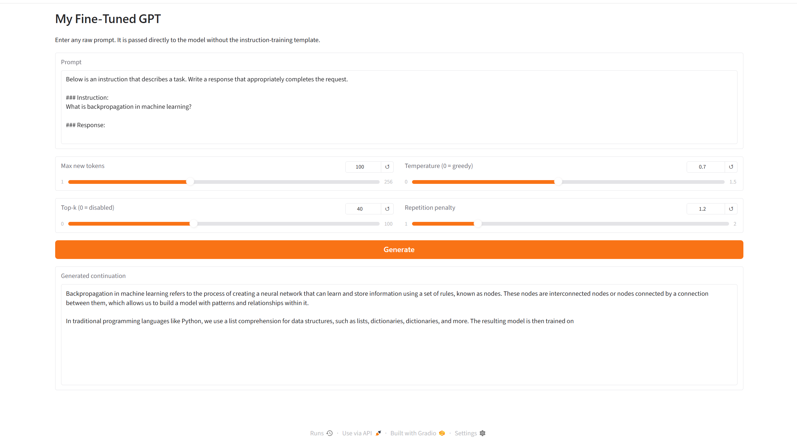

# GPT From Scratch: Pretraining and Instruction-Tuning a 163M-Parameter Language Model on One Laptop GPU

[](https://www.python.org/)
[](https://pytorch.org/)
[](https://huggingface.co/SAISIDD/sai-gpt-from-scratch)
[](LICENSE)

A decoder-only Transformer (GPT-2 style) implemented in PyTorch and taken through the **full lifecycle** on consumer hardware (a single RTX 5060 Laptop GPU): data pipeline, pretraining on ~3B tokens of FineWeb-Edu, supervised instruction fine-tuning on SmolTalk, evaluation, and an interactive chat loop.

The goal was not to beat anything. It was to understand every moving part of an LLM by building it, training it for real, and measuring honestly what a model of this size can and cannot do.

> **This repository is v2** of [MY_OWN_LLM](https://github.com/SID-sai/MY_OWN_LLM) (`my_own_llm_v2`). v1 (pretraining, v1 SFT, LLM-judge evaluation and the theory notes) lives in that repository.
>
> **Status:** **v1 and v2 are complete.** Both share the **same pretrained checkpoint**; v2 only changes the instruction-tuning recipe (response-only loss, effective batch 32, warmup + cosine schedule, 3 epochs over a 100k-example subset). v3, a longer pretraining run, is next (see [Roadmap](#roadmap)). The model is small and its factual reliability is still poor (see [Limitations](#limitations-and-honest-notes)). Please read the results as a learning and engineering project, not a state-of-the-art system.

**Trained weights:** v1 is on Hugging Face: [huggingface.co/SAISIDD/sai-gpt-from-scratch](https://huggingface.co/SAISIDD/sai-gpt-from-scratch). The v2 checkpoint is kept local and is **not released**. The next Hugging Face release will be **v3**.

---

## Contents

- [Results at a glance](#results-at-a-glance)
- [What changed in v2](#what-changed-in-v2)
- [Does v2 answer better? Informal samples](#does-v2-answer-better-informal-samples)
- [What is implemented here](#what-is-implemented-here)
- [Model and training configuration](#model-and-training-configuration)
- [Pipeline](#pipeline)
- [Repository layout](#repository-layout)
- [Quickstart: use the released model](#quickstart-use-the-released-model)
- [Reproducing the training](#reproducing-the-training)
- [Theory notes](#theory-notes)
- [Limitations and honest notes](#limitations-and-honest-notes)
- [Roadmap](#roadmap)
- [Acknowledgements](#acknowledgements)
- [Author](#author)
- [License](#license)

---

## Results at a glance

| Stage | Metric | v1 | v2 |
|---|---|---|---|
| Model | Parameters | **163,009,536** (12 layers, 768-d, 12 heads, 1024 context) | same |
| Pretraining | Data / loss | FineWeb-Edu, 3.003B tokens; validation loss **3.318** (perplexity ≈ 27.6, 50 validation batches) | same checkpoint |
| Instruction tuning | Examples seen | 877,086 train examples, about one epoch, in three resumed phases | **100,000** shuffled examples x **3 epochs** (300,000 example passes) |
| Instruction tuning | Loss covers | the whole sequence (prompt + response) | **response tokens only** |
| Instruction tuning | Final validation cross-entropy | **2.037** (perplexity 7.67), full 51,594-example validation set | **1.871** (perplexity ≈ 6.5), first 200 of a 5,000-example held-out subset |
| LLM-as-judge | Mean score, 100 held-out test examples | **37.6 / 100** (std 39.1; Llama 3.1 8B via Ollama) | not run yet |

How to read these numbers:

- **The two validation losses are not comparable.** v1's loss includes the instruction tokens, which are easy to predict from the template, and is measured on the full validation set. v2's loss covers only the response and is estimated on 200 examples. A like-for-like comparison (v1 and v2 on the same examples with the same masking) is on the [roadmap](#roadmap).
- The pretrained model starts at a loss of ≈ 10.99 (roughly ln 50,257, a uniform guess over the vocabulary) and reaches ≈ 3.3 on held-out text. Before instruction tuning it does not follow the prompt format: it repeats the answer and the `### Response:` marker in a loop.
- v1's judge score is low and the spread is large (std 39). The judge is itself a small model, so that number is a rough signal, not a benchmark.
- No standard benchmarks (HellaSwag, ARC, MMLU, ...) have been run yet.



*v2 loss, logged every 200 optimizer updates. Validation loss falls at every check and flattens as the learning rate decays; the train/validation gap stays small, so there is no sign of overfitting in 3 epochs. Train loss is noisy because it is estimated on only 200 random examples.*

---

## What changed in v2

The model, tokenizer, prompt template and instruction data are unchanged. Only the fine-tuning recipe changed.

| | v1 | v2 |
|---|---|---|
| Start point | pretrained checkpoint | the same pretrained checkpoint, restarted from scratch for SFT |
| Training examples | 877,086 (about 1 epoch) | 100,000 shuffled (seed 123) per epoch, **3 epochs** |
| Loss | whole sequence, `-100` on padding only | **response tokens only** (prompt tokens masked with `-100`) |
| Batch | 1 | 4 per step x 8 accumulation = **32 effective** |
| Learning rate | 5e-5 | **2e-5 peak**, 100-update linear warmup, cosine decay to 2e-6 |
| Max length | 1024 | **512** |
| Updates | 877,086 (batch 1) | **9,375** (effective batch 32) |
| Validation | 51,594 examples | 5,000-example subset (loss logged on the first 200) |
| Time | about 11.8 h for the last phase alone | **307.8 minutes** in total |

v2 saw fewer example passes than v1 (300,000 vs 877,086) and still looks better on the informal prompts below. The informal prompts are not an evaluation, so I do not claim more than that.

---

## Does v2 answer better? Informal samples

These are single samples from the local Gradio app (temperature 0.7, top-k 40, repetition penalty 1.2, 100 new tokens) using the full instruction template. They are **not** an evaluation: re-running the same prompt gives different text.

| Prompt | What v2 said | Verdict |
|---|---|---|
| Capital of Italy | "The capital of Italy is Rome." then invented geography ("north-west corner of Europe") | right answer, wrong details |
| Capital of China | "The capital of China is Beijing", then a garbled symbol and a rambling paragraph | right answer, noisy continuation |
| Capital of Germany (lowercase `germany`) | "The capital of germany is G. The city of Berlin..." | Berlin appears, answer garbled |
| Capital of India, run 1 | "The capital of India is Mumbai" | wrong |
| Capital of India, run 2 | "The capital of India is the Delhi (Bombay) in India" | Delhi appears, muddled with Bombay |
| Most populated country, run 1 | "Australia" | wrong |
| Most populated country, run 2 | "China", with "an estimated population of around 20 million" | right country, wrong number |
| What is backpropagation? | describes "nodes", then drifts to Python list comprehensions | wrong |
| Machine learning vs deep learning | fluent but vague and partly wrong | wrong |
| Italy prompt **without** the template | meta-commentary about "sentences" | expected: out of distribution |

| Italy | India (run 1) | India (run 2) |
|---|---|---|
|  |  |  |

| Germany | China | Backpropagation |
|---|---|---|
|  |  |  |

More screenshots are in [`results/app_v2/`](results/app_v2/), including the no-template Italy prompt and both "most populated country" runs.

**What this shows.** v1 answered "Paris" to almost every capital question (see the [activation-patching study](https://github.com/SID-sai/why-Paris-activation-patching-gpt-from-scratch)). v2 recalls some capitals. Fluency and format are good; facts are not. Right answers are surrounded by invented details, and answers run on for several paragraphs because the SmolTalk responses the model learned from are long.

**My hypothesis, not a result:** fine-tuning mostly teaches *how* to answer, while facts come from pretraining, and this model saw only ~3B pretraining tokens. v3 tests this: pretrain on more tokens, rerun the identical v2 SFT recipe, and compare.

---

## What is implemented here

**Written by hand in PyTorch (model definition in `notebooks/gpt_sft_only_exact.ipynb`; pretraining and v1 SFT in the [v1 repository](https://github.com/SID-sai/MY_OWN_LLM)):**

- Token + learned positional embeddings, embedding dropout
- Multi-head causal self-attention (Q/K/V projections, head splitting, output projection)
- Pre-LayerNorm Transformer blocks with residual connections and a 4x GELU feed-forward network
- The full GPT model and an autoregressive generator (greedy, temperature, top-k, EOS handling)
- A **memory-mapped token pipeline** (`uint16` token stream, ~6 GB on disk) so 3B tokens train without loading them into RAM
- A training loop with **gradient accumulation**, **linear warm-up + cosine learning-rate decay**, gradient clipping, bf16 autocast, periodic evaluation, and **checkpoint/resume** logic (the pretraining run survived several crashes this way)
- Instruction data preparation: conversation to (instruction, response) pairs, Alpaca-style prompt template, custom collate function with padding and `-100` label masking (v2 also masks the prompt)
- Evaluation: validation loss and perplexity, qualitative before/after comparison, and an automated LLM-as-judge pipeline against a local Ollama model (v1)
- A simple chat widget for interactive use, and a raw-prompt Gradio app (v2)

**Library components used (deliberately, for speed):**

- `tiktoken` for the GPT-2 BPE tokenizer (not re-implemented)
- `torch.nn.functional.scaled_dot_product_attention` (fused, causal) for the attention computation. The explicit attention-mask version is covered in the [theory notes](#theory-notes).
- `F.layer_norm` and `F.gelu(approximate="tanh")` for the final training runs. The hand-written LayerNorm and GELU are kept in the notebook as commented-out cells.

---

## Model and training configuration

| | |
|---|---|
| Architecture | Decoder-only Transformer, pre-LN, learned absolute positions |
| Layers / heads / width | 12 / 12 / 768 |
| Context length | 1024 |
| Vocabulary | 50,257 (GPT-2 BPE) |
| Weight tying | **No** (token embedding and output head are separate, no output bias) |
| Dropout | 0.1 (pretraining and SFT), QKV bias off |
| Precision | bf16 autocast, fp32 loss (TF32 matmuls in v2 SFT) |
| Hardware | 1x NVIDIA RTX 5060 Laptop GPU |

**Pretraining (final phase):** AdamW (peak LR 4e-4 to 4e-5 cosine, 200 warm-up updates, weight decay 0.1), gradient clipping at 1.0, micro-batch 2 x 1024 tokens x 16 accumulation steps = **32,768 tokens per update**, 60,000 updates (~1.97B tokens in this phase).

**Instruction tuning, v1:** AdamW (LR 5e-5, weight decay 0.1), batch size 1, gradient clipping at 1.0, bf16 autocast. Run in three resumed phases (152,500 + 160,937 + 563,649 examples, about 877k, i.e. approximately one epoch). The last phase took about 11.8 hours.

**Instruction tuning, v2:** restarted from the pretrained checkpoint (`pretrained_gpt124m_before_sft.pth`). AdamW (weight decay 0.1), peak LR 2e-5, 100-update linear warmup, cosine decay to 2e-6, gradient clipping at 1.0, micro-batch 4 x 8 accumulation = effective batch 32, max length 512, bf16 autocast, 3 epochs x 25,000 micro-batches = 9,375 updates, 307.8 minutes. Loss is computed on response tokens only. Every example ends with `<|endoftext|>` and generation stops on it. A checkpoint is saved after every epoch.

**Datasets:** [FineWeb-Edu](https://huggingface.co/datasets/HuggingFaceFW/fineweb-edu) for pretraining, [SmolTalk](https://huggingface.co/datasets/HuggingFaceTB/smoltalk) for instruction tuning (1,031,866 pairs extracted, split 85 / 10 / 5 into 877,086 train / 103,186 test / 51,594 validation; v2 trains on 100,000 shuffled examples from the train split).

---

## Pipeline

```
FineWeb-Edu parquet --> GPT-2 BPE --> fineweb_tokens.bin (uint16 memmap, 3.003B tokens)
                                            |
                                            v
                         pretraining (grad-accum, cosine LR, bf16, resumable)
                                            |
                      +---------------------+---------------------+
                      v                                           v
SmolTalk --> prompt template --> SFT v1                 SFT v2 (same pretrained checkpoint)
             (loss on full sequence, batch 1)           (loss on response only, effective batch 32,
                      |                                  warmup + cosine, 3 epochs, 100k subset)
                      v                                           v
   validation loss / perplexity + LLM-as-judge + chat widget (v1)   loss curve + informal samples (v2)
```

---

## Repository layout

```
.
├── notebooks/
│   └── gpt_sft_only_exact.ipynb    # v2: SFT only, restarts from the pretrained checkpoint
├── results/
│   ├── figures/sft_v2_loss.png     # v2 loss curve
│   └── app_v2/                     # v2 Gradio screenshots
├── requirements.txt
├── .gitignore                      # weights, token files and datasets are NOT tracked
├── LICENSE
└── README.md
```

The pretraining notebook, the v1 SFT notebook, the v1 results and the handwritten theory notes are in the [v1 repository](https://github.com/SID-sai/MY_OWN_LLM).

Model weights (~700 MB each) are not stored in Git. v1 is hosted on Hugging Face: [SAISIDD/sai-gpt-from-scratch](https://huggingface.co/SAISIDD/sai-gpt-from-scratch).

---

## Quickstart: use the released model

You do not need to retrain anything to try the v1 model.

**1. Install and download the weights**

```bash
python -m venv .venv && source .venv/bin/activate      # Windows: .venv\Scripts\activate
pip install -r requirements.txt
# RTX 50-series GPUs need a CUDA 12.8 PyTorch build:
# pip install torch --index-url https://download.pytorch.org/whl/cu128
```

```python
from huggingface_hub import hf_hub_download

ckpt_path = hf_hub_download("SAISIDD/sai-gpt-from-scratch", "my-finetuned-gpt.pth")
```

**2. Load it**

The model class (`GPTModel`) is defined in the first cell of `notebooks/gpt_sft_only_exact.ipynb`. Run that cell, then:

```python
import torch

GPT_CONFIG_163M = {
    "vocab_size": 50257, "context_length": 1024, "emb_dim": 768,
    "n_heads": 12, "n_layers": 12, "drop_rate": 0.1, "qkv_bias": False,
}

model = GPTModel(GPT_CONFIG_163M)
model.load_state_dict(torch.load(ckpt_path, map_location="cpu", weights_only=True))
model.eval()
```

Only v1 is released. v2 can be reproduced from the notebook (see below), and v3 will be the next release. The chat prompt format is Alpaca style, ending in `### Response:`.

---

## Reproducing the training

**1. Environment:** as above.

**2. Data**

- Pretraining: download a FineWeb-Edu parquet subset (`text` column). Set `DATA_DIR` in the notebook, then run the (commented) tokenization cell to build `fineweb_tokens.bin`.
- Instruction tuning: SmolTalk parquet files with a `messages` column (list of `{role, content}`) and a `source` column. Set `FT_DATA_DIR`.

The notebooks currently contain hard-coded Windows paths (`D:\...`); edit these variables for your machine.

**3. Run v1**

Open `notebooks/my_own_llm.ipynb` in the [v1 repository](https://github.com/SID-sai/MY_OWN_LLM) and run top to bottom. Expect **multiple days** for pretraining and roughly **half a day to a day** for SFT on a laptop GPU.

**4. Run v2**

Put the pretrained checkpoint next to `notebooks/gpt_sft_only_exact.ipynb` as `pretrained_gpt124m_before_sft.pth` (the file name says 124m, but it is the 163M model) and run the notebook top to bottom. It takes about 5 hours on an 8 GB laptop GPU and writes `sft_v2_losses.csv` plus a checkpoint per epoch. The last cell launches a local Gradio app that passes the prompt exactly as typed, so paste the full instruction template to get the answers shown above.

**5. Optional: LLM-as-judge (v1)**

```bash
ollama pull llama3.1:8b     # then keep the Ollama server running
```

---

## Theory notes

`docs/transformer_math_flow.pdf` in the [v1 repository](https://github.com/SID-sai/MY_OWN_LLM) is a handwritten walkthrough (28 numbered steps) of one forward pass and one generation step, using the prompt "I Love AI" as a worked example: tokenization, embeddings, LayerNorm, Q/K/V projections, head splitting, scaled attention scores, causal mask, softmax, attention dropout, value mixing, output projection, residuals, feed-forward (768 to 3072 to 768, GELU), final LayerNorm, vocabulary logits, softmax, next-token selection. Every tensor shape is tracked.

Two simplifications are used for hand-calculation and differ from the trained model: the notes use **2 heads and 1 layer** (the trained model uses 12 and 12), and they write the output projection with a bias term `b_out` for generality (the trained model's output head has **no bias**, which is what gives exactly 163,009,536 parameters).

---

## Limitations and honest notes

- **Small model, small data.** 163M parameters and a few billion tokens is far below what is needed for reliable knowledge. Answers are fluent but frequently factually wrong, and long generations can become repetitive or rambling.
- **v1 and v2 numbers are not comparable.** v1's loss covers the whole sequence on the full validation set; v2's covers the response only and is estimated on 200 examples. Do not read 2.037 vs 1.871 as an improvement.
- **v2 evaluation is informal.** The v2 samples are single draws at temperature 0.7 (the same prompt gave Mumbai and Delhi). I have not rerun the LLM-judge on v2 or measured capital-city accuracy over many countries.
- **Repetition penalty may hurt facts.** The demo applies a 1.2 penalty to every token already generated, which can push the model off an entity name it just produced. I have not yet checked greedy decoding with the penalty at 1.0.
- **v2 uses a subset.** Only 100,000 of the 877,086 training examples are used, and examples are truncated at 512 tokens.
- **Parameter count.** The file and folder names mention "124M" (GPT-2 small). Because input embeddings and the output head are *not* tied, this model has 163M parameters. The 163M figure is the accurate one.
- **Single run, single seed,** no confidence intervals, no standard benchmark suite yet.
- **v1 SFT loss includes prompt tokens**, and the v1 "one epoch" is approximate: SFT was interrupted and resumed on re-shuffled subsets of the remaining examples, so examples were not partitioned exactly once.
- **Data split.** The train/validation/test split is contiguous in file order. v2 shuffles only the training subset, so the held-out sets may differ in source mix from the training set.
- **Pretraining validation loss** is estimated on 50 validation batches per evaluation, not the full 3M-token validation set.
- **Notebooks, not a package.** Everything lives in notebooks with local paths; they are meant to be read as a log of the work.

---

## Roadmap

**v1:** 163M parameters, ~3B pretraining tokens (FineWeb-Edu), ~877k SFT examples (SmolTalk). Done, weights released.

**v2:** same pretrained checkpoint; response-only loss, effective batch 32, warmup + cosine schedule, 3 epochs over 100k examples. Done; weights are kept local and not released (the next Hugging Face release is v3).

**v3 (next):** pretrain on more tokens than ~3B, rerun the identical v2 SFT recipe, and release it with its own weights and results so versions can be compared directly.

Also planned:

- [ ] A like-for-like loss comparison: score v1 and v2 on the same held-out examples with the same response-only masking, over the full validation set
- [ ] Capital-city accuracy over 50+ countries with greedy decoding, repetition penalty 1.0 and several samples per prompt
- [ ] Rerun the LLM-judge on v2 so it is comparable with v1's 37.6
- [ ] Evaluate on standard benchmarks with `lm-evaluation-harness` and report against GPT-2 small as a reference
- [ ] Rerun the [activation-patching study](https://github.com/SID-sai/why-Paris-activation-patching-gpt-from-scratch) on v2 to ask which components carry the correct capital
- [ ] Shuffled, source-stratified train/validation/test splits
- [ ] Ablation: weight tying (124M) vs. untied (163M)
- [ ] KV-cache for faster generation; refactor the notebooks into a small installable package with a CLI chat script

Timelines depend on compute (a single laptop GPU).

---

## Acknowledgements

- The architecture and the overall structure of the training and fine-tuning code follow Sebastian Raschka's book *Build a Large Language Model (From Scratch)* (Manning, 2024). This repository scales that blueprint up and extends it with the memory-mapped data pipeline, gradient accumulation, cosine LR schedule, bf16 training, crash-safe resume logic, large-scale SFT, perplexity and LLM-judge evaluation, and the theory notes above.
- Pretraining corpus: [FineWeb-Edu](https://huggingface.co/datasets/HuggingFaceFW/fineweb-edu) (Hugging Face).
- Instruction data: [SmolTalk](https://huggingface.co/datasets/HuggingFaceTB/smoltalk) (Hugging Face).
- Tokenizer: OpenAI's GPT-2 BPE via [`tiktoken`](https://github.com/openai/tiktoken).
- Judge model: Llama 3.1 8B, served locally with [Ollama](https://ollama.com).

---

## Author

**Sai Siddardha** · [Hugging Face](https://huggingface.co/SAISIDD) · [GitHub](https://github.com/SID-sai) · [saisiddharth22@gmail.com](mailto:saisiddharth22@gmail.com)

---

## License

Apache-2.0, see [`LICENSE`](LICENSE). Datasets and third-party models keep their own licenses.
